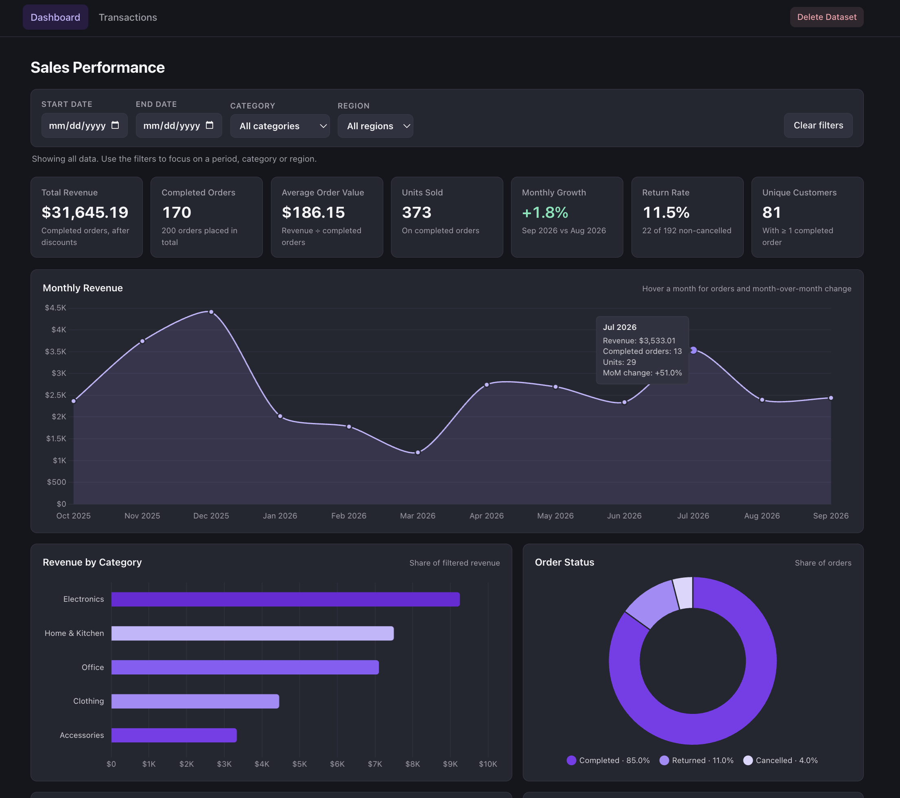
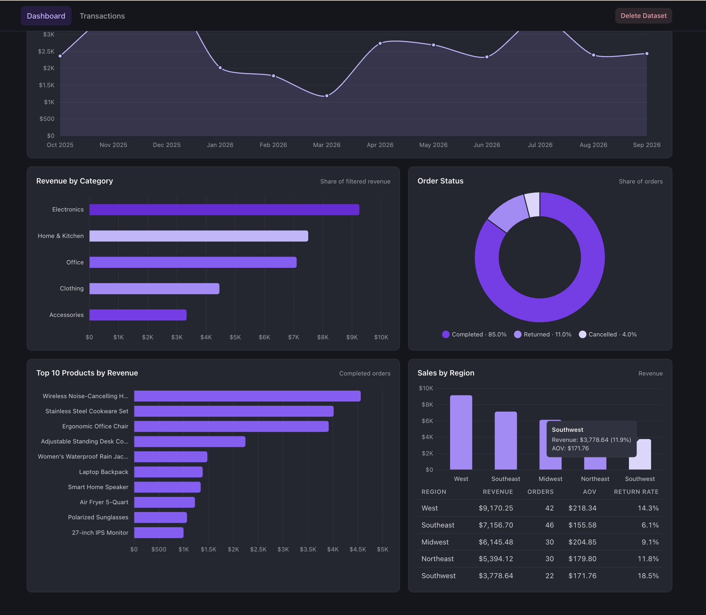
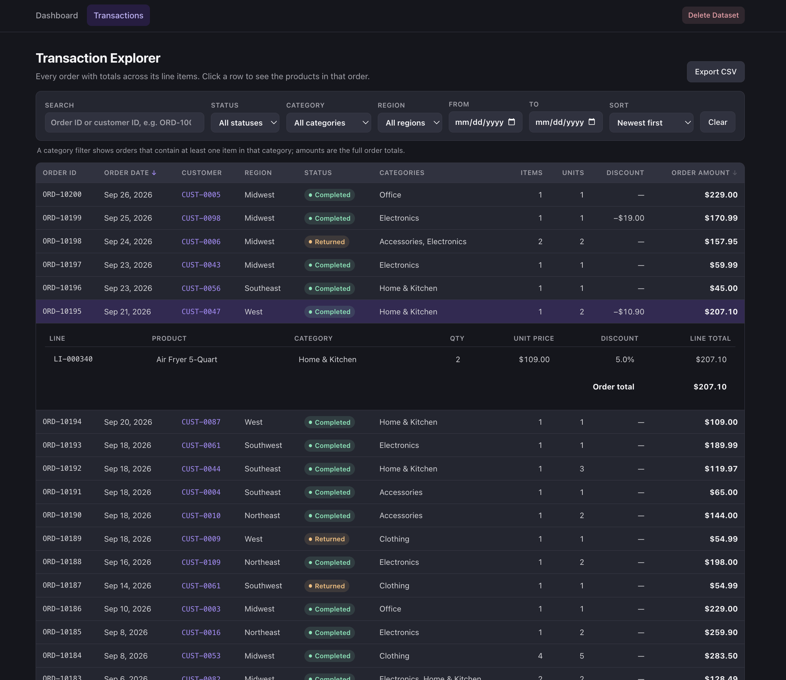
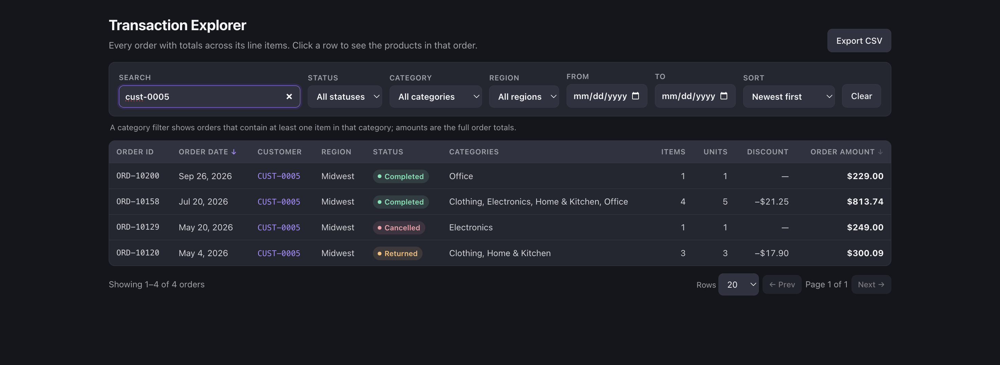

# Sales Dashboard

A web application for exploring e-commerce sales data, built with Java and Spring Boot. Users can upload their own CSV files or load a sample dataset to analyze sales performance through interactive charts and dashboards. All metrics are calculated using SQL queries against a local H2 database.





### Transaction Dashboard




## Features

- **Summary metrics:** total revenue, completed orders, average order value, units sold, monthly growth, return rate and unique customers
- **Charts:** monthly revenue, revenue by category, top 10 products, sales by region and order status
- **Filters:** narrow everything down by date range, product category or region
- **Transaction explorer:** search by order or customer ID, filter by status, sort, page through orders, see the line items in each order, and export the results to CSV
- **One dataset at a time:** upload your own CSV or load the included sample data, then delete it to start over
- **CSV validation:** if any row has a problem, you get a clear error message and nothing is saved

## Tech Stack

- Java 21, Spring Boot 4 (Spring MVC, JDBC, Validation)
- H2 database (file-based, so data is kept between restarts)
- Thymeleaf, HTML, CSS and JavaScript
- Chart.js
- Apache Commons CSV
- JUnit 5 and Spring Boot Test
- Maven Wrapper

## Getting Started

Install **Java 21**

Run the app:
```bash
./mvnw spring-boot:run
```

On Windows, use `mvnw.cmd spring-boot:run`. Then open <http://localhost:8080>.


## Testing

The project includes automated JUnit tests for the CSV import, the SQL metrics, api, pages, and data persistence across restarts.

```bash
./mvnw test
```
